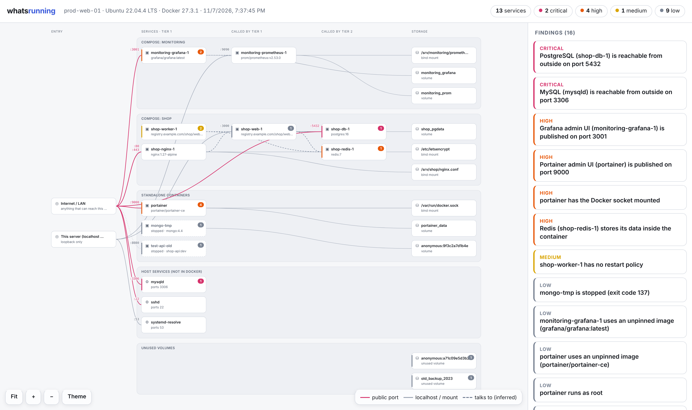

# whatsrunning

See what is really running on a server, how it is connected, and what is risky. One command, one static binary, nothing leaves the machine.

**[Live demo](https://ravalimeka.github.io/whatsrunning/)**

<picture>
  <source media="(prefers-color-scheme: dark)" srcset="docs/screenshot-dark.png">
  
</picture>

```
$ sudo whatsrunning

whatsrunning  prod-web-01 · Ubuntu 22.04.4 LTS
  10 containers (8 running) · 3 host services · 11 volumes · 8 public ports

  Findings: 2 critical, 4 high, 1 medium, 9 low

  CRITICAL PostgreSQL (shop-db-1) is reachable from outside on port 5432
           fix: Remove the port mapping, or bind it to localhost: "127.0.0.1:5432:<container port>".
  CRITICAL MySQL (mysqld) is reachable from outside on port 3306
  HIGH     Portainer admin UI (portainer) is published on port 9000
  HIGH     portainer has the Docker socket mounted
  HIGH     Redis (shop-redis-1) stores its data inside the container
  ...
  Map written to /root/whatsrunning.html
```

`whatsrunning.html` is an interactive map of the box: what faces the internet, which service calls which, where data lives, and every finding with a fix.

## Why not read the compose file?

A compose file says what someone meant to run. whatsrunning reads what is actually running:

| | Compose-to-diagram tools | whatsrunning |
|---|---|---|
| Source | a YAML file | live containers, ports, volumes and native services |
| Hand-started containers and leftovers | missed | shown |
| Native services (MySQL, sshd, ...) | missed | shown |
| Service links | `depends_on` only | `depends_on` plus connection strings |
| Security findings with fixes | no | yes |
| Install | Python, Graphviz or Node | one static binary |

## Install

Linux, amd64 or arm64. Verify the checksum before running anything as root:

```bash
ARCH=$(uname -m | sed 's/x86_64/amd64/;s/aarch64/arm64/')
BASE=https://github.com/RavaliMeka/whatsrunning/releases/latest/download
curl -fsSLO "$BASE/whatsrunning_linux_$ARCH.tar.gz" -O "$BASE/checksums.txt"
sha256sum --check --ignore-missing checksums.txt && tar xzf "whatsrunning_linux_$ARCH.tar.gz"
```

Or build from source:

```bash
go install github.com/RavaliMeka/whatsrunning/cmd/whatsrunning@latest
```

`whatsrunning demo` maps a sample server, if you want to look before scanning your own.

## Usage

```
whatsrunning [scan] [flags]   scan this machine (default)
whatsrunning demo  [flags]    map a sample server

  -o FILE              HTML map output (default "whatsrunning.html", "-" to skip)
  -json FILE           also write graph and findings as JSON ("-" for stdout)
  -docker-socket PATH  Docker socket (default /var/run/docker.sock or $DOCKER_HOST)
  -no-docker           skip Docker
  -no-ports            skip host listening ports
  -v                   also print low-severity findings
  -fail-on SEVERITY    exit 2 if any finding is at least SEVERITY
```

Run as root or as a member of the `docker` group. Without root, some host processes show as "unknown".

In CI or cron, `whatsrunning -o - -fail-on critical` fails the job the day a database is opened to the world.

## Checks

| Severity | Check |
|---|---|
| critical | Database, cache or queue reachable from outside (Docker or native) |
| critical | Docker API listening on the network |
| high | Admin UI published (Portainer, Adminer, phpMyAdmin, pgAdmin, Grafana, Kibana, Jenkins, ...) |
| high | Docker socket mounted into a container |
| high | Privileged container |
| high | Database without a volume: data is lost on the next recreate |
| medium | Database on an anonymous volume, host network, host PID, no restart policy |
| low | Stopped containers, unused volumes, unpinned images, root user on exposed services |

Docker-published ports bypass UFW and firewalld. Many people find this out the hard way.

## Privacy

- No network calls, no telemetry, no account.
- Environment variable values are never stored. Only names are kept; values are read in memory to detect links and then dropped.
- Secrets in command lines (`--password=...`, `token`, `key`, `user:pass@` in URLs) are redacted.
- Reports are written with mode 0600 and contain no external resources.

See [SECURITY.md](SECURITY.md) for the threat model and how to report a vulnerability.

## Roadmap

- [x] Docker, host ports, findings, interactive map
- [ ] Reverse proxies (nginx, Caddy, Traefik): `domain → proxy → container → db`
- [ ] Many servers over SSH, no agent, with cross-server links
- [ ] AWS security groups, load balancers and RDS joined with the in-host view
- [ ] Azure, GCP, Kubernetes, systemd units, `whatsrunning diff`

A new check is one function in [`internal/rules`](internal/rules/rules.go). A new data source implements [`Collector`](internal/collector/collector.go).

## License

MIT
